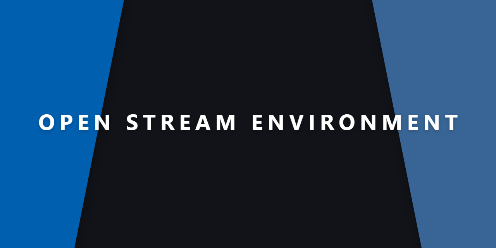

# Open Stream Environment

**[English](README.md) · [Русский](README.ru.md)**

<p align="center">
  
</p>

<p align="center">
  <a href="https://github.com/Halantar-git/open-stream-environment/releases"></a>
  <a href="https://www.gnu.org/licenses/gpl-3.0"></a>
  <a href="https://github.com/Halantar-git/open-stream-environment/actions/workflows/ci.yml"></a>
  <a href="docs/api.md"></a>
  <a href="sdk/README.md"></a>
  <a href="https://www.npmjs.com/package/ose-plugin"></a>
</p>

A stream overlay built on Material Design 3, with a drag-and-drop editor
(Figma-style): move, resize, add and remove widgets live. Written in Tauri 2
(Rust) on top of the system webview. The overlay is served by a local server as
an ordinary web page — add it to OBS as a Browser Source.

Current version: **4.7.3**.

The Russian README is the full one: [README.ru.md](README.ru.md). This English
edition covers everything you need to install, connect services and build the
app; deep internals are summarised.

## 🚀 Quick start

You do not need to build anything for normal use — grab a release.

1. Download the installer for your system from the
   [website](https://ose-overlay.ru) or the
   [Releases](https://github.com/Halantar-git/open-stream-environment/releases)
   page (Windows — `.exe`/`.msi`, Linux — AppImage/deb/rpm, macOS — dmg).
2. Launch the app — the control panel opens.
3. Enable the WebSocket server in OBS: **Tools → WebSocket Server Settings**.
   In the app open **Settings → OBS WebSocket**, enter host, port and password,
   enable the integration and wait for “Connected”.
4. Press **“Set up OBS scenes”** — the app creates the missing scenes and
   browser sources with the right URLs and canvas size. In your main scene add a
   game capture and put it below the “OSE Overlay” source.

If you do not need WebSocket, add the overlay by hand:
**Sources → + → Browser Source**, URL `http://localhost:8710/overlay/overlay.html`,
resolution 1920×1080, FPS 30.

That's it. Build-from-source and requirements are in “Install and run”.

## What's inside

- **Control panel** (`control/`) — one window in the system webview:
  - **Editor** — 16:9 canvas with the overlay preview, widget library on the
    left, layers and properties on the right. Widgets are dragged, resized by
    the handles, added by click or drag from the library, removed with the trash
    button or Delete.
  - **Settings** — Twitch / DonationAlerts / DonateX / YouTube / OBS WebSocket,
    soundboard, Stream Deck, overlay URL, port change and layout reset.
- **Overlay** (`overlay/`) — the page your viewers see: the same layout rendered
  with live data (alerts, chat, donation goal, recent events).
- **Local server** (`src-tauri/src/server/`) — axum + WebSocket in Rust, the
  shared bus between the panel, the overlay and the integrations. The layout
  lives in `config/local-db.json`, the rest of the settings in `config.json`
  (created on first run from `config/config.example.json`).
- **Local database** — layout, settings and sessions; stream events
  (donations/subscriptions/follows) go to the append-only
  `config/local-db.jsonl`, chat history to `config/local-db.chat.jsonl`
  (JSON Lines).
- **Wheel of Fortune** — an interactive pseudo-3D drum (CSS 3D Transforms +
  Canvas) on its own OBS scene (`overlay/wheel-scene.html`).
- **Giveaways** — viewers join by command, duplicates are filtered, names are
  shuffled (Fisher–Yates); elimination mode is available.
- **Chat poll** — a full-screen scene with a live bar or pie chart; viewers vote
  with `!poll 1`, `!poll 2`, … Settings and presets live in the “Poll” panel.
- **Chat bot and automoderation** — built-in Nightbot-style bot: custom commands
  with variables and access levels, timers, built-in `!commands`, and
  automoderation (link protection with an allow-list, bad-word list with
  deleet-ification, caps and emote limits, warnings → timeout → ban). Configured
  in **Settings → Chat bot**.
- **Unified alert widget** — Twitch, DonationAlerts and Wheel notifications in
  one queue; the server owns the order, pausing, rules and missed donations.
- **News ticker** — donations, follows, subs and gifts, rewards, optionally chat,
  goal and top donation. A channel-points reward is shown as a “breaking” bar by
  default. Custom messages can be sent from the remote, Stream Deck or terminal
  (`ticker <text>`, `ticker breaking <text>`).
- **Giveaway participants widget** — live list of viewers on the overlay or on a
  scene canvas.
- **Executive Hangar timer** — the Star Citizen contested-zone cycle
  (Red 2 h → Green 1 h → Black 5 min) with LED dots and the time left in the
  current phase. The server polls the public **Exectimer** source every five
  minutes (and on demand), with fallbacks to Longshot and the last good anchor.
  Two variants: 2D (`timer`) and 3D (`grimhex-timer`).
- **Themes and 3D** — ten built-in themes (Material You, Orbital, Pixel Perfect,
  Terminal, Nuclear, Super Four, Retrowave, Wardogs, TESO, Elite) plus three 3D
  variants (Star Citizen, Cobra Mk II, Ouroboros Seal). About ninety widget types
  counting the themed variants; each theme has its own look for chat, goal,
  alerts, recent events and ticker.
- **Theme editor** — build your own palette, duplicate a built-in theme, export
  and import theme files.
- **Scenes** — full-screen pages for start / BRB / Just Chatting / guests / end,
  plus wheel and poll, each with its own OBS source and URL. Four of them have
  their own widget canvas.
- **Guests (multicam)** — four guest slots plus your own camera over WebRTC, with
  your own TURN server for difficult NATs.
- **Web Remote** — the panel on your phone in the same Wi-Fi network: scenes,
  clip and marker, donation music, death counter, test alerts, wheel, poll, chat.
- **HUD** — chat and widgets over the game, toggled by a hotkey.
- **Stream Deck plugin** — scene switching with active-scene highlight and a
  “message to the ticker” button.
- **Package SDK** — widgets and themes as folders or ZIP packages, loaded without
  rebuilding the app; see [docs/plugin-api.md](docs/plugin-api.md) and
  [sdk/README.md](sdk/README.md).
- **Open API** — local HTTP endpoints and a WebSocket bus with full docs in
  [docs/api.md](docs/api.md) and an OpenAPI schema in [docs/openapi.json](docs/openapi.json).

## Alerts queue

All alerts go through one server-side queue: Twitch events, DonationAlerts and
Wheel notifications. The queue panel (the “DA” button in the header) shows what
is on air and what is waiting, lets you pause alerts, skip one, and set rules:
do not show donations below an amount, merge consecutive donations from the same
viewer within a window. Donations that arrived while the app was closed can be
pulled with **“Fetch missed”** (needs DonationAlerts scope `oauth-donation-index`).

## Appearance and themes

Themes change only the overlay (and its preview on the canvas) — the control
panel always looks the same. Each theme is a set of Material tokens (colours,
fonts, panel shape, alert animation). 3D widgets of a theme can be switched on
per theme with the “3D” toggle on its card; the counter under the canvas shows
**“3D animation: N · X% of screen”**.

The theme editor lets you create a theme, duplicate a built-in one, edit its
colours and CSS, then export it as a file or import it back. Themes are fan
stylisations: no game logos or screenshots, only palette and mood.

## Layout: grid, aspect ratio, lock, presets

- Geometry is stored in percent of the canvas, so the same layout fits any OBS
  source resolution. The canvas aspect ratio is chosen in the editor toolbar and
  must match the OBS source (16:9 by default).
- Grid steps of 2 / 5 / 10 % with snapping; Alt releases a widget from the grid.
- Layout lock prevents accidental dragging; the lock button is in the toolbar.
- Layout presets save the whole widget set and the theme; applying a preset
  restores both. Presets are for the overlay only.
- Settings export/import moves the whole configuration between machines
  (**Settings → Data**), secrets excluded.

## History and data

Everything is local: `config/config.json` for settings, `config/local-db.json`
for layout and sessions, `config/local-db.jsonl` for stream events,
`config/local-db.chat.jsonl` for chat. Backups `.bak.0…2` sit next to the
snapshot; a corrupted file is quarantined and the state is restored from a
backup. Secrets (Twitch, YouTube, DonationAlerts tokens and the OBS WebSocket
password) are encrypted with the OS keystore — DPAPI on Windows, Keychain on
macOS, libsecret on Linux — and are never written in plain text.

The “History” tab shows the full stream history with filters and pagination;
the “Data” settings page offers backup, restore, log export and a support report
with no secrets inside.

## Guest cameras (multicam)

Four slots plus your own camera. A guest opens a link in the browser, video goes
over WebRTC; the public signaling service lives in `signal/` (Cloudflare Workers
+ Durable Object), and you can point the app at your own TURN server. The “Guests”
scene is a 2×2 grid bound to the slots, so a confirmed guest lands in their own
square automatically.

## Custom widget

A text, image, video, HTML or embedded page widget. Its HTML/CSS/JS is edited in
a popup editor and runs inside an isolated `iframe sandbox="allow-scripts"`: a
script error in your widget cannot break the overlay or the bus.

## Chat window and HUD

A separate chat window reads the Twitch chat and can send messages as the
connected account. Chat over the game is read-only and toggled by a hotkey;
editing positions of HUD windows is a separate mode.

## Web Remote

Open the address from **Settings → Network access** on your phone in the same
Wi-Fi network. The URL contains an access code; without it the remote shows
“No access code”. The code can be rotated — old links stop working immediately.

## OBS setup

The overlay and scenes are created by **“Set up OBS scenes”**; scenes, cameras
and effects are controlled through **OBS WebSocket** (OBS 28+).

### Connection

1. In OBS: **Tools → WebSocket Server Settings**, enable the server, note the
   port (default `4455`) and password.
2. In the app: **Settings → OBS WebSocket** — enable the integration, fill in
   host (`127.0.0.1`), port and password. A saved password is never shown; an
   empty field means “do not change”.
3. The **OBS** chip in the header shows the connection state.
4. Press **“Set up OBS scenes”** — missing scenes and sources are created.

### Scenes and switching

Each app scene is a full-screen source in OBS. The setup button creates
`overlay.html` for the main scene, `scene.html?type=start|brb|talk|guests|end`
for scenes, `wheel-scene.html`, `poll-scene.html` and `video-splash.html` for
splashes. Existing scenes and sources are not renamed or removed; a repeated
press updates the URLs after a port change.

Scene names are mapped in **Settings → OBS WebSocket → Scene mapping**
(`main`, `start`, `brb`, `talk`, `guests`, `end`, `wheel`, `poll`, `pause`);
case does not matter. After that scenes switch without manual clicks in OBS:
from the phone remote, Stream Deck, CLI (`scene brb`) or a Twitch channel-points
reward.

The “Scenes” tab in the panel is an editor (preview, properties, URL); it does
not switch the live scene.

### Cameras, microphones, effects

- **Camera** and **microphone** source names are used by the remote buttons.
- **Camera angles** — “OBS scene + camera source”, switched manually or with
  channel points.
- **Filters** — OBS filters (grayscale, blur, pixelate, chroma key) on the chosen
  source, manually or with channel points and a duration.
- **Custom commands** — arbitrary raw obs-websocket v5 requests, run from the
  terminal: `obs <id>`.

## Stack and requirements

- Tauri 2 (Rust backend) with the system webview: WebView2 on Windows,
  WKWebView on macOS, WebKitGTK on Linux.
- Node.js 22.12+ is needed for development only (Jest/ESLint/Prettier and the
  data scripts in `src-tauri/tools/*.mjs`); Node is not shipped with the app.
- Local storage: JSON files in `config/` as described above.
- Pseudo-3D components use CSS 3D Transforms over HTML5 Canvas (GPU-accelerated).

## Architecture principles

- **Zero-CPU idle.** 3D widgets run their own `requestAnimationFrame` loop capped
  at 30 FPS (decorative — 20 FPS), and the loop sleeps when nothing animates or
  the widget is hidden. Animated widgets pause when `document.hidden` is set.
- **Deterministic animation.** Positions are computed from time deltas, so frame
  drops do not teleport elements.
- **Sandboxed user code.** Custom widgets and packages live in isolated iframes.
- **Mic bridge.** The panel captures the microphone (OBS blocks audio capture in
  plain HTTP), compresses the waveform to ~371 bytes and sends binary frames over
  the local bus to overlay/scene clients at ~30 Hz.
- **Video bridge (optional).** The webcam widget can encode H.264 via WebCodecs
  (JPEG fallback) and send frames over the same bus; it runs only while a visible
  live widget exists.
- **Secret vault.** Tokens and passwords are encrypted with the OS keystore.
- **Atomic, non-blocking writes.** JSON state is written through a temp file and
  rename, asynchronously with coalescing; event history is append-only with a
  lazy index.
- **Crash guard and observability.** Uncaught errors write a report, flush state
  and show a dialog; `GET /healthz` returns machine-readable state, and “Save
  report” collects it without secrets.

## Network access

The panel, overlay and HUD work from this computer without a code. Anything from
the local network — the phone remote, third-party scripts — must present the
access code shown in **Settings → Network access**, otherwise the port stays
silent. The code travels in the URL in clear text; rotate it if the address leaks.

## Install and run (from source)

Rust (stable) and Node.js 22.12+ are required.

```bash
npm install
npm run tauri:dev
```

A splash screen appears for a moment, then the panel window opens. The overlay
is already available at `http://localhost:8710/overlay/overlay.html`.

To build a bundle:

```bash
npm run tauri:build
```

For backend debugging, `cargo run --manifest-path src-tauri/Cargo.toml` works too.

## Performance and OBS limits

The overlay is a web page, so rendering in the Browser Source is the cost — not
the Rust backend (fractions of a percent).

- **Source FPS — 30.** Widgets do not animate faster anyway.
- **Static scene backgrounds.** Material blurred shapes are drawn once.
- **Enable “Shutdown source when not visible”.** Without it Chromium inside OBS
  may not set `document.hidden`, and hidden scenes keep rendering.
- Keep “Refresh browser when scene becomes active” off.
- Resolution 1920×1080; 4K roughly quadruples the fill cost.
- Heavy widgets are animated 3D ones (radar, hologram, sign, shield, orb/cube):
  keep **2–3** on a scene and do not stretch them over the whole screen. The
  editor counter shows the total.
- 2D widgets (chat, goal, recent events, counters) are cheap.
- One mic visualizer is enough: its capture runs only while the widget exists.

Measure with OBS **View → Stats** and the OS GPU/CPU monitor.

## Testing

```bash
npm test                                           # Jest, front-end
npm run lint                                       # ESLint + Prettier
cargo test --manifest-path src-tauri/Cargo.toml --lib
cargo clippy --manifest-path src-tauri/Cargo.toml --all-targets -- -D warnings
```

## Twitch

**Chat** connects anonymously — only the channel name is needed (default
`halantar`), editable in Settings. Reading needs no auth; sending from the chat
window and the remote is done as the connected account and needs the OAuth below.

**Follow/sub/cheer alerts** need a registered application:

1. Open https://dev.twitch.tv/console/apps → “Register Your Application”
   (a button is in the app settings).
2. Set the redirect URI exactly as shown in Settings
   (default `http://localhost:8710/oauth/twitch/callback`).
3. Copy the Client ID, create a Client Secret and paste both into Settings.
4. Press “Connect Twitch” — the browser opens; after confirming, the app picks
   the token up itself.

Scopes: `moderator:read:followers`, `channel:read:subscriptions`, `bits:read`;
`channel:read:redemptions` for the soundboard and point redemptions;
`user:write:chat` for sending messages; `moderator:manage:banned_users` for bot
timeouts and bans; `clips:edit` and `channel:manage:broadcast` for clips and
markers; `channel:manage:redemptions` for reward management. After adding scopes,
press “Connect Twitch” again to reissue the token.

Channel emotes are fetched from Helix separately (anonymous chat does not show
them). To render emotes of channels you are subscribed to, `user:read:emotes` is
needed — reconnect once after updating.

## Chat bot and moderation

**Settings → Chat bot** enables the built-in Nightbot-style bot:

- **Commands** — name, response template, access level (everyone / subs / mods /
  streamer), global and per-user cooldowns. Variables in responses: `$(user)`,
  `$(channel)`, `$(args)`, `$(count)`, `$(random a|b|c)`.
- **Built-in `!commands`** lists the commands available to the viewer.
- **Timers** — periodic messages with an interval and a minimum chat activity.

**Automoderation**: link protection with an allow-list (default: `youtube.com`,
`youtu.be`, `clips.twitch.tv`, `twitch.tv`, `boosty.to`); a bad-word list with
deleet-ification (look-alike Latin/digit characters are normalised to Cyrillic);
caps and emote limits; cumulative warnings — the first violation deletes the
message and warns, the second gives a timeout, the third a permanent ban.
Moderators, the streamer and VIPs are skipped.

The bot replies through Twitch Helix as the channel (`user:write:chat`) and
times out/bans through `POST /helix/moderation/bans`
(`moderator:manage:banned_users`). Warnings are stored in `local-db.json`. In the
terminal, `modtest <message>` checks a text through moderation without banning.

The bot works with Twitch only: YouTube chat messages reach the overlay and the
chat window but not commands, timers or moderation.

## DonationAlerts

1. Open https://www.donationalerts.com/application/clients and create an app.
2. Redirect URI — as shown in Settings
   (default `http://localhost:8710/oauth/donationalerts/callback`).
3. Paste the Client ID and Secret into Settings, press “Connect DonationAlerts”.

Donations add to the goal and trigger alerts; the order is managed by the alert
queue.

**If you connected DonationAlerts before:** the “Fetch missed” button needs the
`oauth-donation-index` scope. Existing tokens do not gain new scopes, so the app
must be **deleted and created again** in the DA cabinet, then connected once
more. Everything else (live donations, alerts, goal, TTS) works without it.

**Recreated the app — paste both keys.** A new app has new Client ID and Secret;
the symptom of old keys is `invalid_client` / “Client authentication failed”. The
Client Secret field is never pre-filled (it is a secret); an empty field means
“do not change the saved secret”. If the config was moved to another machine or
the OS keystore is unavailable, the app tells you which secrets must be entered
again and the field shows “saved secret cannot be read”.

**Where to look if it does not connect.** The attempt is logged: the “DA” panel
shows `donationAlerts: token exchange failed` with what was sent (client_id,
secret length, redirect_uri) and what the service answered; the same lines are in
`logs/ose-<date>.log`. The `config loaded` line shows which `config.json` was
read.

**Donation TTS** (Settings → DonationAlerts) reads the donation message aloud in
the overlay: language, voice, volume, rate and a test button, via the Web Speech
API — works in a browser and in the OBS Browser Source.

**The “DA” panel** in the header opens three panes: DonationAlerts itself, the
alert queue to its left and “Waiting” further left. It shows connection state,
token health, quick actions (reconnect, test donation, fetch missed, service TTS
toggle), the last ten donations with “Repeat alert”, the stream donation counter
and a live log filtered to DonationAlerts.

Connection settings (Client ID/Secret, “Connect”) stay on the Settings tab.

## DonateX

Donations arrive in real time over the SignalR hub: alert, goal update, donation
track and the AI character reply (if enabled in the DonateX cabinet).

1. In the DonateX cabinet open **Settings → API and access** and copy the
   **external token** ([donatex.gg/streamer/settings](https://donatex.gg/streamer/settings),
   API docs: [donatex.gg/api-docs/authentication](https://donatex.gg/api-docs/authentication)).
2. In the app: Settings → DonateX, paste the token and enable the integration. An
   empty field means “do not change the saved token”; the token is never shown.

Donations join the common alert queue. The donation track is shown by the
“Donation music” widget, the AI reply by the “DonateX AI character” widget.

Widget links — donation, AI character and music — are set in **Settings →
DonateX**: copy the `https://donatex.gg/widgets/…` addresses from the cabinet.
The overlay opens them hidden, so DonateX plays the sound and OSE shows the track
name; without links the built-in AI character and player are used.

## Scenes (start / BRB / Just Chatting / guests / end / wheel / poll)

The “Scenes” tab is not widgets over the game but full-screen pages, each with
its own URL for an OBS source (you switch the whole scene when the game is not
visible):

- **Stream start** — status badge, title, countdown.
- **BRB** — the same for a technical break.
- **Just Chatting** — background and widget canvas: chat, camera and alerts are
  widgets on the canvas.
- **Guests** — a 2×2 multicam grid and chat on the right, bound to guest slots.
- **Stream end** — thanks for watching, no timer.
- **Wheel of Fortune** — full-screen 3D drum; volume and spin speed are set in
  the scene form, participants are a normal widget.
- **Poll** — full-screen live chart.

Each scene can play a video/image/GIF splash when it appears.

## Building

```bash
npm run tauri:build
```

Bundles go to `src-tauri/target/release/bundle/`. CI builds Windows, Linux and
macOS on every release tag; a GitHub release draft is created automatically.

## Project structure

```
control/                — editor + settings (system webview)
overlay/                — page for the OBS Browser Source, scenes, wheel, poll
chatwindow/             — separate chat window (read + send)
widgeteditor/           — HTML/CSS/JS editor for the custom widget
themeeditor/            — theme editor window
remote/                 — mobile web remote
streamdeck-plugin/      — Elgato Stream Deck plugin
sdk/                    — package SDK (create/validate/pack, types, schemas)
splash/                 — startup splash
shared/                 — MD3 tokens, widget styles, icons, widget catalog
assets/fonts/           — bundled theme fonts (woff2, Latin+Cyrillic) and licences
signal/                 — public signaling for guest cameras (Cloudflare Workers)
src-tauri/              — Rust backend (Tauri 2)
  src/server/           — axum static, /ws, access, CLI, OAuth, commands
  src/state/            — layout, runtime, poll, themes, config, scenes
  src/storage/          — config, db, history, media, secrets, integrity, logs
  src/integrations/     — Twitch, DonationAlerts, YouTube, OBS WebSocket, bot
docs/                   — API, OpenAPI, plugin API, platform notes
config/                 — config.example.json, media/ (user data, not committed)
tests/                  — Jest tests (backend is covered by cargo test)
```

## Developer documentation

- [API](docs/api.md) — local HTTP server, WebSocket bus, remote actions,
  examples and the full list of frames.
- [OpenAPI](docs/openapi.json) — machine-readable HTTP schema (3.1).
- [Package API](docs/plugin-api.md) — widget and theme package format.
- [Package SDK](sdk/README.md) — scaffolding, manifest validation and
  `window.OSE` types; on npm as `ose-plugin` (`npx ose-plugin create`).
- [Widget API plan](docs/plugin-api-plan.md) — stages, sandbox and open questions.

## Planned integrations

Platform notes for services we looked at but have not connected yet:

- [VK Video Live](docs/vk-video-live.md) — chat can be read and written, but the
  API has no moderation at all, and without a VK account and a registered app
  even the connection cannot be tested.

## Known limitations

- The server port can be changed on the fly, but the OBS Browser Source URL and
  already open chat/remote windows are not switched automatically.
- The layout is stored in percent, so it scales to any source resolution; the
  canvas aspect ratio must match the OBS source.
- Full-screen scenes and their previews are 16:9 for now.
- After changing the Twitch channel, reconnect EventSub on the Settings tab.
- HUD modes work over windowed/borderless games; exclusive fullscreen hides them.
- The phone remote needs the access code in the URL.

## Credits

This project uses free audio from Freesound.org (Creative Commons Attribution):

* **Wheel Spin sound** — by [roulettevision](https://freesound.org/people/roulettevision/), [sound 420891](https://freesound.org/people/roulettevision/sounds/420891/) (CC BY 3.0)
* **Jingle_Win_00 & Jingle_Lose_01** — by [LittleRobotSoundFactory](https://freesound.org/people/LittleRobotSoundFactory/), [sound 270333](https://freesound.org/people/LittleRobotSoundFactory/sounds/270333/) and [sound 270334](https://freesound.org/people/LittleRobotSoundFactory/sounds/270334/) (CC BY 4.0)
* **Buzzer (notification sound)** — “alarm clock buzzer alarm beep”, by [Garuda1982](https://freesound.org/people/Garuda1982/), [sound 530172](https://freesound.org/people/Garuda1982/sounds/530172/) (CC0); the shipped file is a trimmed fragment

### Widget ideas

* [CH_AK](https://www.twitch.tv/ch_ak) — idea for the “UEC transfer” widget.

---

Full Russian documentation lives in [README.ru.md](README.ru.md).
